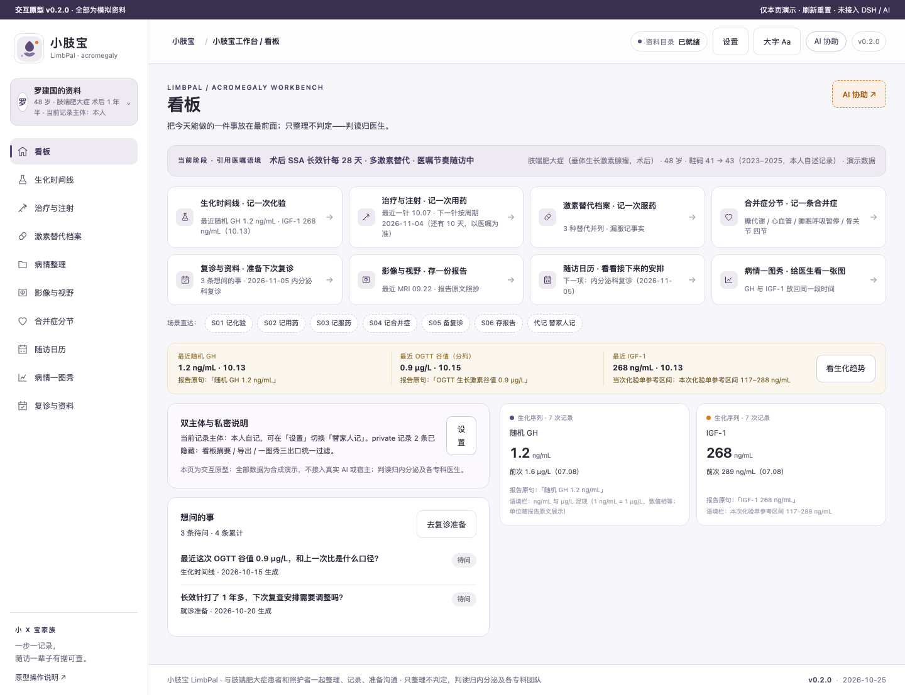
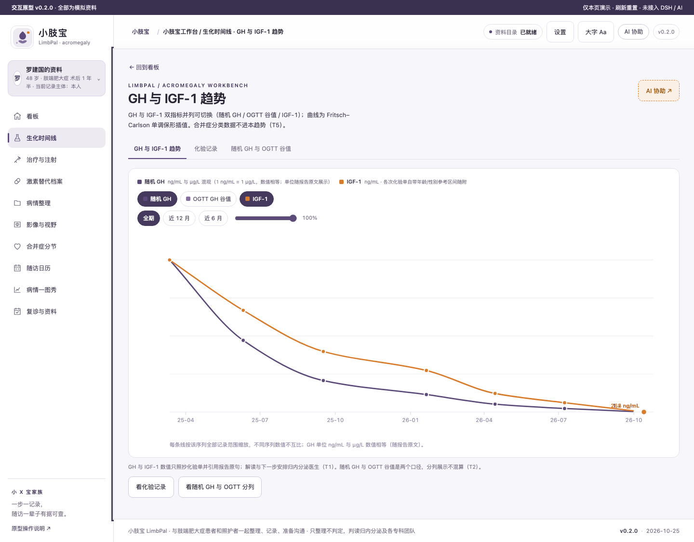
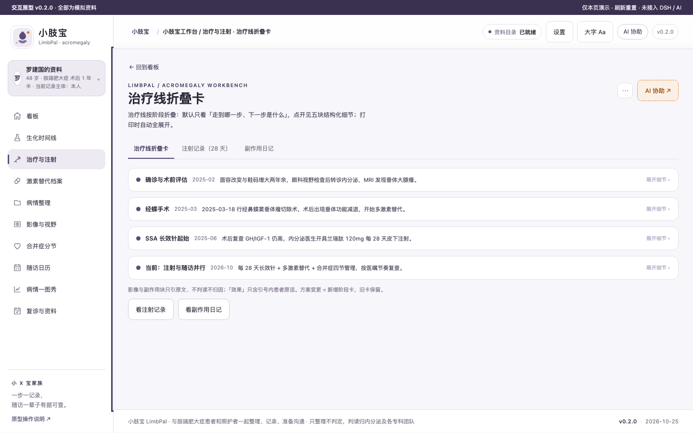
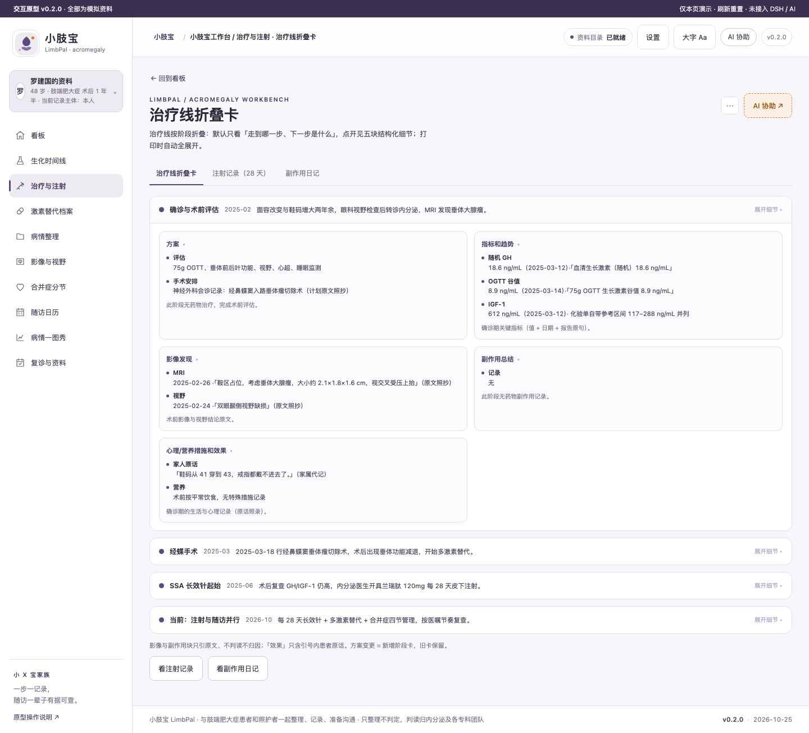
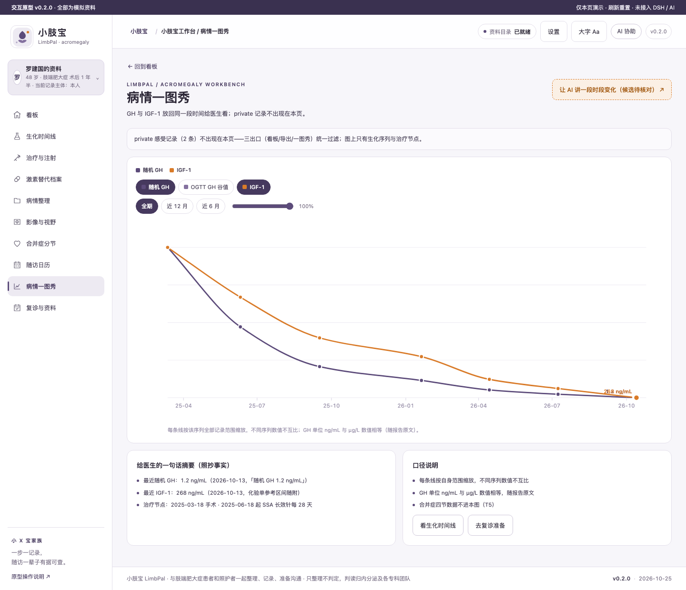
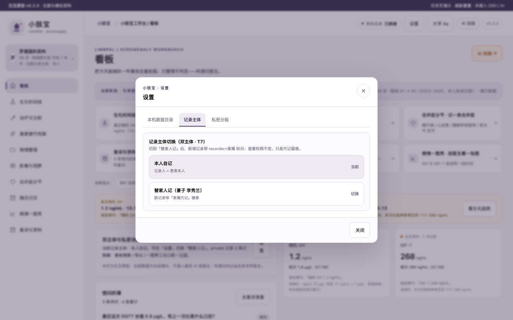

# 小肢宝 LimbPal · 肢端肥大症患者工作台

面向肢端肥大症患者与照护者的本机病程资料工作台：GH/IGF-1 生化时间线、垂体手术后激素替代双主体档案、生长抑素类似物等药物注射周期、合并症（糖代谢/心血管/睡眠呼吸暂停/骨关节）分节轨道。**只整理不判定：不做诊断、不做治疗建议，判读归内分泌及各专科团队。**

## 关键功能（原型 v0.2 实渲，Chromium 1440 宽）

| 截图 | 回答什么 |
| --- | --- |
|  | "我现在该做什么"——四点位与双主体入口 |
|  | "化验单上的 GH / IGF-1 这些数放在一起什么样"——数值照抄+报告原句，随机 GH 与 OGTT 谷值分列 |
|  | "现在打到哪个阶段、什么时候打的"——注射周期折叠卡收起态 |
|  | 展开态：方案/指标/影像/副作用/心理营养五块 |
|  | "变化发生在哪一步"——给医生看一张图（private 三出口过滤） |
|  | 本机数据目录 / 本人或替家人记 / 私密分级 |

## 怎么用（安装）

Desktop 本地 tgz / profile `pnpm add`；首次使用先新建会话（宿主按会话授权）。详见 [docs/RELEASE.md](docs/RELEASE.md)。

## 数据与口径

患者数据本机优先，不引入静默上传；临床试验一律"登记状态，未核实"；医学底本《86 个罕见病病种诊疗指南（2025 年版）》#3 与中国肢端肥大症诊治共识（2021 版）仅作范围参照。当前版本见 [VERSION](VERSION)。

## 开发

```
npm run check      # 静态包合同
npm test           # 包内容测试
npm run audit      # 家族一致性
```

文档索引：[docs/](docs/)；差异化与页面树见 [docs/DIFF-MATRIX.md](docs/DIFF-MATRIX.md) 与 [docs/SPEC.md](docs/SPEC.md)。
